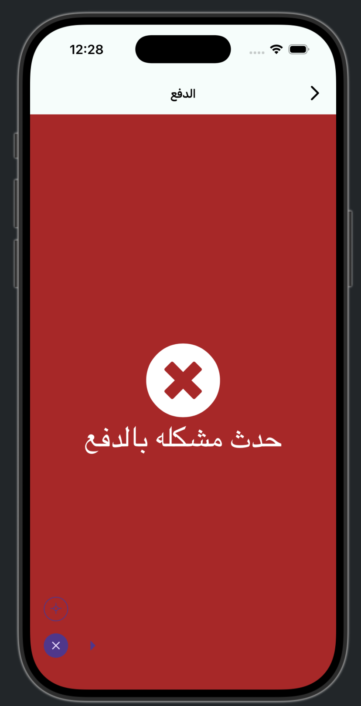

# Backend Task: Card payment fails with "حدث مشكله بالدفع" after the last step

## Summary

On iOS, the user opens the payment page in the app, enters the card details, and submits the last step (the bank / 3-D Secure confirmation). The page then shows a red error screen:

> ❌ **حدث مشكله بالدفع** ("A problem occurred with the payment")

This screen is **not** from the app. It is the page the server or the payment gateway loads inside the payment web view. The app only opens the `payment_url` that the backend returns and waits for a URL containing `/success`. So the cause is in the payment backend, the gateway setup, or the callback. We need you to find why the payment failed and fix it.

## Details of the failed test

| Field | Value |
|---|---|
| Date / time | 2026-10-15, about 12:28 (device time, Kuwait) |
| Platform | iOS Simulator (iPhone), app in Arabic |
| Flow | ☐ Playground booking (`POST /bookings`)   ☐ Game booking (`POST /games/{id}/confirm-booking`)   ☐ Wallet top-up (`POST /add-balance`) |
| Payment method | Card (Visa / Mastercard) |
| User account (phone) | `__________` |
| Amount | `______ KWD` |
| Card used | ☐ Test card   ☐ Real card |
| Last URL shown in the web view | `__________` (from the app's debug log `✅ PageFinished: …`) |

## How the app handles payment

1. The app calls one of the endpoints above. The response contains `payment_url`.
2. The app opens `payment_url` in an in-app web view (JavaScript on, nothing injected).
3. The app watches every page that finishes loading:
   - If the URL path contains **`/success`**, the app treats the payment as successful, refreshes the profile, and shows the success screen. It reads `paymentId` from the query string.
   - **Any other page is just shown as is.** There is no failure URL the app understands, so after the error above the user can only press Back.

## Questions to answer

| # | Question |
|---|---|
| Q1 | What does the server / gateway log show for this payment (around 12:28 on 2026-10-15)? Please share the gateway's error code and message. |
| Q2 | Which gateway is used for cards, and is it in **test** or **live** mode on `https://futblha.com/api`? Does that match the card that was used (test card on live mode, or real card on test mode, both fail)? |
| Q3 | Which URL shows "حدث مشكله بالدفع": our server's callback / error page, or the gateway's own page? |
| Q4 | What happens to the booking (or wallet top-up) after this failure: is it marked failed, does it stay pending and hold the playground slot, or is it cancelled? |

## Tasks

| # | Task | Priority | Done? |
|---|---|---|---|
| T1 | Answer Q1–Q4 | Critical | ☐ |
| T2 | Find and fix the root cause. Check: gateway API keys and mode, the callback / return URL set on the gateway, the 3-D Secure setup, the amount and currency sent (KWD with 3 decimals), and that the callback verifies the payment with the gateway rather than trusting the redirect | Critical | ☐ |
| T3 | After a failed or cancelled payment, mark the booking / top-up as **failed** and free the playground slot (see `BACKEND_TASKS_PLAYGROUND_BOOKING_CONFLICTS.md`, T9). Don't charge the wallet part if the card part failed | High | ☐ |
| T4 | Redirect failures to a fixed URL so the app can detect them, for example `https://futblha.com/payment/failed?paymentId=…&reason=<code>`, and keep success on a URL containing `/success` with `paymentId`. Tell us the final URLs and we will handle the failure screen in the app (message + retry) | High | ☐ |
| T5 | Show a translated, clear reason on the error page (for example "Card declined" / "تم رفض البطاقة", "3-D Secure failed" / "فشل التحقق من البطاقة") instead of a general message | Medium | ☐ |
| T6 | Make sure the callback is idempotent: if the gateway calls it twice, the booking is confirmed once and the wallet is changed once | Medium | ☐ |

## Test we will run

1. Book a playground and pay with a valid card (test card in test mode, or real card in live mode).
   - **Expected:** the web view reaches a `/success` URL. The booking is confirmed.
2. Pay with a card that is declined, or cancel the 3-D Secure step.
   - **Expected:** the web view reaches the failure URL from T4 with a `reason`. The booking is marked failed and the slot is free again.
3. Repeat steps 1 and 2 for a game booking and a wallet top-up.
4. Repeat in English and Arabic.

## Please reply with

- Your answers to Q1–Q4.
- The status of each row in the table.
- The final success and failure URLs (T4).
